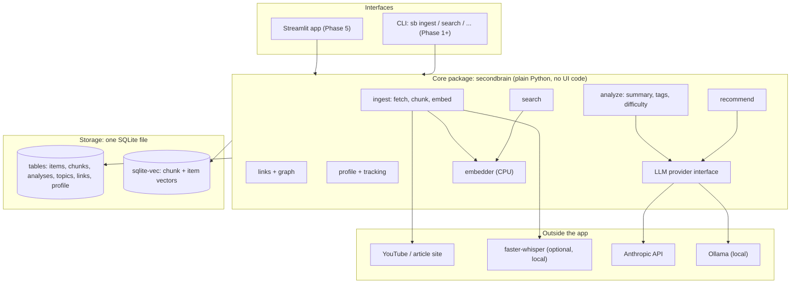
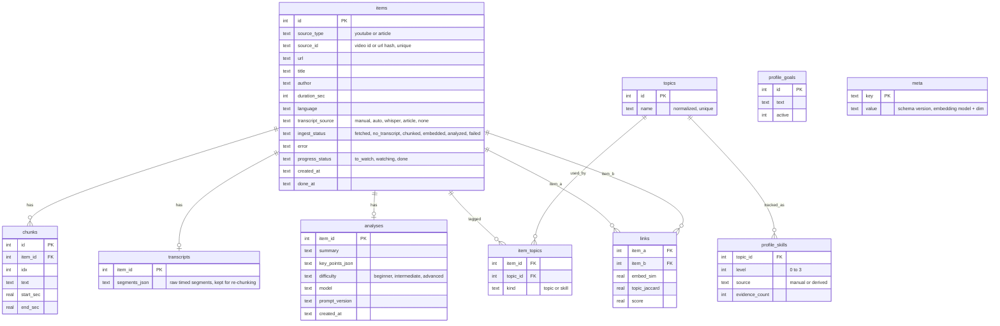

# Second Brain — Design Doc (Phase 0)

Status: **approved 2026-11-16** · This is the original plan, kept as written. Where the build differs, [DECISIONS.md](DECISIONS.md) and the phase notes say what changed and why.

---

## 1. Goal

A local app that saves long learning content (mostly YouTube), understands it, links related items, and suggests what to learn next based on a personal profile.

One sentence test of success: *"I paste a URL, and a week later I can find it by meaning, see what it relates to, and get a sensible 'watch this next' list with reasons."*

## 2. Scope

### In scope (v1)
| # | Feature | What "done" means |
|---|---------|-------------------|
| 1 | Save | Paste a YouTube URL (or article URL) → metadata + transcript stored. No transcript → item is marked `no_transcript`; optional local Whisper transcription. |
| 2 | Understand | Per item: summary, key points, topic tags, skill tags, difficulty. LLM output is JSON validated by a Pydantic schema. |
| 3 | Search | Semantic search over all chunks, results grouped per item, with the best-matching passage and a timestamp link. |
| 4 | Connect | Item-to-item links from embedding similarity + shared topics. "Related to this" list + graph view. |
| 5 | Recommend | Ordered "learn next" list with a one-line reason each, based on profile (skills, goals, finished items). |
| 6 | Track | `to_watch` / `watching` / `done`. Marking done updates profile skills. |

### Out of scope (v1)
- Browser extension, mobile app, share-sheet capture.
- Multi-user, auth, cloud sync, deployment.
- Playlists/channels bulk import (single URLs only; a simple "one URL per line" file import is in).
- Other platforms (Instagram, X, Reddit). The source type column leaves room for them.
- "Background web research" on each item (in the original idea; pushed to a later version — it adds a web-search dependency and a second eval problem).
- Hybrid keyword + vector search, rerankers, ANN indexes. Added only if the retrieval eval shows a need.
- A separate FastAPI backend (see §7).

## 3. Architecture



Key idea: **the UI and CLI are thin**. All logic lives in the `secondbrain` package, so every feature is testable with pytest and usable from the CLI before the UI exists.

## 4. Components

| Component | Responsibility | Notes |
|-----------|----------------|-------|
| `config` | Load `.env` into one typed settings object | Fails at startup with a clear message if a required value is missing. |
| `db` | SQLite connection, schema creation, schema version check | Also loads the sqlite-vec extension and fails loudly if it cannot. |
| `ingest.youtube` | Video ID parsing, metadata, captions | Prefers manual captions, then auto captions. |
| `ingest.article` | Article text extraction | Same output shape as YouTube: metadata + list of text segments. |
| `ingest.transcribe` | Optional Whisper transcription | Only imported when used; installed as an optional extra. |
| `ingest.chunking` | Segments → overlapping chunks with timestamps | Pure function, no I/O. |
| `ingest.pipeline` | Runs the stages in order, records status per stage | Each stage is idempotent, so a failed item can be retried from where it stopped. |
| `embed` | Text → vectors on CPU | One model, loaded once. |
| `vectors` | Insert + KNN query on sqlite-vec | The only file that knows sqlite-vec SQL. |
| `llm` | `LLMProvider` with one method: `generate_json(system, user, schema)` | Two implementations: Anthropic, Ollama. Tests use a fake provider. |
| `analyze` | Prompts + schema + map-reduce for long transcripts | One retry on invalid JSON, feeding back the validation error. |
| `search` | Query → top items with best passage | |
| `links` | Compute and store item links; export graph (nodes, edges) | |
| `profile` | Skills, goals, progress status, "done" updates | |
| `recommend` | Candidate scoring + LLM ordering and reasons | |
| `cli` | Typer commands for every feature | |
| `app/` | Streamlit pages | Phase 5. |
| `scripts/eval.py` | Runs eval set, writes `docs/EVAL.md` | Phase 6. |

## 5. Data flow

### 5.1 Save + understand (per URL)
1. **Parse** URL → `source_type` + `source_id`. Duplicate → return the existing item (no re-ingest).
2. **Fetch metadata** (title, channel, duration, publish date).
3. **Fetch transcript**: manual captions → auto captions → none.
   - none → `ingest_status = no_transcript`. The item is still saved and trackable. User can trigger Whisper.
4. **Chunk**: merge caption snippets into ~220-word chunks with ~40-word overlap, cut on snippet boundaries, keep `start_sec`/`end_sec`.
5. **Embed** each chunk on CPU; store vectors. Item vector = normalized mean of its chunk vectors.
6. **Analyze** (LLM): transcript → JSON `{summary, key_points[], topics[], skills[], difficulty}` → Pydantic validation → store.
   - Transcript longer than the configured input budget → summarize windows first, then combine (map-reduce). Needed because small local models have small context windows.
   - The prompt includes the existing topic vocabulary and asks the model to reuse names, to limit tag fragmentation ("RAG" vs "retrieval augmented generation").
7. **Link**: compare the new item with all others, store links above threshold.

Every stage writes `ingest_status` (and `error` on failure). Nothing fails silently: the CLI exits non-zero; the UI shows the error and a retry button.

**Estimated time is computed, not guessed by the LLM**: video duration for videos, word count ÷ 200 wpm for articles.

### 5.2 Search
query → embed → KNN over chunk vectors (top 30) → group by item, item score = best chunk score → top 5–10 items, each with its best passage and a `?t=` timestamp link.

### 5.3 Linking
`score = 0.7 × cosine(item_vec_a, item_vec_b) + 0.3 × jaccard(topics_a, topics_b)`
Link stored if `score ≥ threshold`; at most top 5 links shown per item.
The weights and threshold above are **starting values, not validated**. They are set in Phase 3 by looking at the score distribution on seed data, then frozen before the labelled pairs are scored (see §11).

### 5.4 Recommend
1. Candidates = items not `done` and successfully analyzed.
2. Deterministic score per candidate:
   - **goal fit** — similarity between item vector and goal text embedding
   - **novelty** — share of the item's topics not yet in profile skills
   - **readiness** — item difficulty vs the user's level in those topics (penalize big jumps)
3. Top ~10 candidates (compact cards: title, topics, difficulty, duration) + profile → LLM → ordered list with one-line reasons, as validated JSON. IDs outside the candidate list are rejected.
4. If the LLM call fails: show the deterministic order with template reasons **and a visible warning** saying so.

### 5.5 Track
Status change → `items.progress_status`. On `done`: each topic/skill of the item gets evidence added in `profile_skills`; level is derived from a simple documented rule (number of finished items in that topic and the highest difficulty finished). Manually set skill levels are never overwritten.

## 6. Data model



Vector tables (sqlite-vec virtual tables, same file): `vec_chunks(chunk_id, embedding float[384])`, `vec_items(item_id, embedding float[384])`.

`meta` stores the embedding model name and dimension. If `.env` later names a different model, the app refuses to mix vectors and tells you to re-embed.

Expected scale: up to ~1,000 items × ~50 chunks ≈ 50k vectors × 384 dims ≈ 77 MB. Exact (brute-force) search is enough at this size.

## 7. Tech choices

| Area | Choice | One-line reason | Main alternative |
|------|--------|-----------------|------------------|
| Python env | `uv`, Python pinned to 3.12 | Kubuntu 26.04's system Python is 3.13/3.14 (sources disagree); pinning avoids missing wheels for native libs. | System Python + venv |
| Captions | `youtube-transcript-api` 1.x | Returns timed snippets directly, no API key. | `yt-dlp` subtitle download |
| Metadata + audio | `yt-dlp` | De-facto standard; also gives the audio file Whisper needs. | YouTube Data API (needs key + quota) |
| Articles | `trafilatura` | One call from URL to clean main text. | `newspaper3k`, `readability-lxml` |
| Transcription | `faster-whisper`, default model `small`, `int8`, device auto | Fits easily in 4 GB and is usable on CPU; `turbo` on GPU is a documented upgrade. | `whisper.cpp`, OpenAI `whisper` |
| Embeddings | `BAAI/bge-small-en-v1.5` (384-dim) via `fastembed` (ONNX, CPU) | Small, strong for English retrieval, and no PyTorch install (~GBs saved). | `sentence-transformers` (pulls in torch); `multilingual-e5-small` if content is not English |
| Vector store | `sqlite-vec` | Vectors live in the same SQLite file as everything else; no server, one backup file. | Chroma, LanceDB, FAISS |
| DB access | stdlib `sqlite3` + hand-written SQL | ~10 tables; an ORM would be more code to study, not less. | SQLAlchemy / SQLModel |
| Schemas | Pydantic v2 | Validation of LLM JSON + typed settings in one library. | `jsonschema` |
| LLM (default) | Anthropic API, small Haiku-class model, set by `LLM_MODEL` | Low cost; summaries and tagging do not need a frontier model. Exact model ID confirmed against the docs in Phase 2. | — |
| LLM (local) | Ollama, a ~3–4B model at 4-bit | Fits 4 GB VRAM. Exact model picked in Phase 2 by measured JSON-validity rate, not by reputation. | llama.cpp directly |
| CLI | Typer | Type-hint based, very little code. | argparse |
| UI | **Streamlit** (agreeing with the brief) | Pure Python, forms/tables/status built in — right fit for a single-user tool and a non-frontend dev. | Gradio (weaker for multi-page apps), NiceGUI, FastAPI + React (far more work) |
| Graph view | `pyvis` rendered inside Streamlit | Interactive graph from a node/edge list in a few lines. | `streamlit-agraph`, Plotly |
| Backend API | **None** | Streamlit imports the core package directly. A FastAPI layer would be an unused abstraction today; the core package makes adding one later easy. | FastAPI |
| Tests | pytest, recorded fixtures, fake LLM provider | Tests run offline and cost nothing. | — |

Library versions are pinned in Phase 1 after a real install on the target Python.

## 8. Repo layout (planned)

```
second-brain/
├── README.md  .env.example  .gitignore  pyproject.toml
├── docs/        DESIGN.md  DECISIONS.md  EVAL.md  phases/phase-N.md
├── src/secondbrain/
│   ├── config.py  db.py  schemas.py  embed.py  vectors.py
│   ├── ingest/  youtube.py  article.py  transcribe.py  chunking.py  pipeline.py
│   ├── llm/     base.py  anthropic_provider.py  ollama_provider.py
│   ├── analyze.py  search.py  links.py  profile.py  recommend.py
│   └── cli.py
├── app/         streamlit_app.py  pages/
├── scripts/     eval.py
├── eval/        retrieval.yaml  links.yaml  summaries.yaml
├── tests/       fixtures/
└── data/        (git-ignored: SQLite file, audio cache, model cache)
```

## 9. Risks

| # | Risk | Impact | Mitigation |
|---|------|--------|------------|
| R1 | YouTube blocks or changes its unofficial endpoints. `youtube-transcript-api` raises `RequestBlocked`/`IpBlocked` when an IP is blocked; cloud IPs are commonly blocked. | Ingest breaks. | App runs on your home/campus IP (usually fine). Specific error message for blocks. Fallback path: `yt-dlp` subtitles, then Whisper. Keep both libraries easy to upgrade. |
| R2 | **My build environment cannot reach YouTube, has no GPU and no Ollama.** | I cannot run live ingest, Whisper-on-GPU, or Ollama tests myself. | Offline tests with recorded fixtures must pass before each phase ends. Live checks are marked `@pytest.mark.live` and listed in each `phase-N.md` for you to run (one command). Phase docs will say plainly what was *not* verified live. |
| R3 | Recent `yt-dlp` needs an external JavaScript runtime (Deno) for YouTube. *From memory — to be verified in Phase 1.* | Extra setup step. | README install step + startup check with a clear message. |
| R4 | `sqlite-vec` is pre-1.0 (latest stable 0.1.9); and Python's `sqlite3` must allow loading extensions. | Breaking changes; extension may not load on some Python builds. | Pin the version. All vector SQL is in one file (`vectors.py`). Startup check. Fallback: Chroma. |
| R5 | Small local models produce invalid JSON or weak summaries. | Analysis fails or is low quality on Ollama. | Schema-constrained output where the provider supports it, Pydantic validation always, one retry with the error fed back, item marked `failed` with reason after that. JSON-validity rate is measured in the eval. |
| R6 | Topic tags fragment (many near-duplicate names). | Weak linking and profile. | Existing vocabulary in the prompt + name normalization. Embedding-based tag merging only if the eval shows a problem. |
| R7 | 4 GB VRAM contention: Whisper and an Ollama model cannot both sit on the GPU. | Out-of-memory. | Embeddings stay on CPU. Whisper and LLM stages run one after the other, never in parallel. Peak VRAM is measured on your laptop in Phase 1 and written to the phase doc. |
| R8 | Auto-captions have no punctuation and contain errors. | Noisier chunks and summaries. | Chunk on caption-snippet boundaries (not sentences). Store `transcript_source` so quality can be compared by source in the eval. |
| R9 | Long ingest blocks the Streamlit page. | UI feels stuck for long videos or Whisper. | Stage-by-stage progress display; pipeline is resumable; CLI is available for bulk/long jobs. A background worker is deliberately not built in v1. |
| R10 | Eval set is small (25 / 30 / 15). | Numbers are noisy. | Report raw counts next to every metric; no claims beyond what was measured. |
| R11 | LLM judge shares blind spots with the summarizer. | Faithfulness score looks better than it is. | Written rubric, claim-level judging, your 5-item spot check, and the judge-vs-human agreement rate reported. |

## 10. Phase plan

Your six phases are kept. Three small adjustments are marked **(adj)**.

| Phase | Scope | Exit check |
|-------|-------|-----------|
| 1 | Ingest + storage: config, DB schema, YouTube + article fetch, optional Whisper, chunking, embeddings, vector store, CLI `sb ingest` / `sb list`. **(adj)** Stage timings are logged from day one so the speed eval needs no extra work. | Offline tests pass. You run one live ingest. |
| 2 | Understand: provider interface (Anthropic + Ollama), schema, prompts, map-reduce, `sb analyze`. | Tests with fake provider pass. You run one live analyze per provider you plan to use. |
| 3 | Search + links + graph data (`sb search`, `sb related`, graph export as nodes/edges). **(adj)** The graph *picture* is drawn in Phase 5; Phase 3 produces and tests the graph *data*. **(adj)** I hand you the label templates (`eval/*.yaml`) at the end of this phase so you can label while Phases 4–5 are built. | Tests pass. |
| 4 | Profile, progress tracking, recommendations (`sb profile`, `sb status`, `sb recommend`). | Tests pass. |
| 5 | Streamlit UI: Add, Library, Item detail (summary, related), Search, Graph, Recommendations, Profile. | Tests for UI-facing helpers pass; app starts with an empty and a seeded DB. |
| 6 | `scripts/eval.py`, `docs/EVAL.md`, README polish, cleanup. | Eval run on your laptop; results file generated by the script. |

## 11. Eval plan

All numbers in `docs/EVAL.md` are written by `scripts/eval.py` from a real run. The file header records: date, git commit, hardware, corpus size, and the full config (LLM provider + model, embedding model, chunk size, link weights + threshold). No manual edits, no estimates.

| Area | Data | Method | Metrics |
|------|------|--------|---------|
| Retrieval | ~25 queries, each with hand-labelled relevant item IDs | Run search, compare item-level top results to labels | **recall@5** = relevant items found in top 5 ÷ all relevant items, averaged over queries. **MRR** = average of 1 ÷ rank of the first relevant item (0 if none in top 20). |
| Linking | ~30 item pairs labelled related / unrelated | Predicted "related" = a stored link exists. Pairs are sampled across the score range (high / middle / random) and you label them **without seeing scores**. | **precision, recall**, plus the raw confusion counts. |
| Summaries | ~15 items | LLM judge with a written rubric (`eval/RUBRIC.md`): each summary sentence and key point is marked *supported / not supported / contradicted* by the transcript. | **faithfulness** = supported claims ÷ all claims. Also: judge-vs-you agreement on your 5 spot-checked items. |
| Speed | Ingest logs + search runs | Per-stage timing per video; search timed over the query set, repeated, model already loaded | **ingest time per video** (by stage, with video length), **search latency p50 / p95**. Model load time reported separately. |
| Extra (free) | Analysis logs | Count first-try schema passes | **JSON-validity rate** per provider/model; **tokens per item** from API usage fields. |

Honesty rules for the eval:
- Link weights/threshold are frozen before pair labels are scored. If they are tuned afterwards, both the before and after numbers are reported and the tuned one is labelled as tuned on the eval set.
- The corpus must exist before labelling: the eval needs roughly 30+ really ingested items (see Q5).
- Speed numbers come from your laptop only.

## 12. Config (`.env`)

`LLM_PROVIDER` (`anthropic` | `ollama`), `LLM_MODEL`, `LLM_MAX_INPUT_TOKENS`, `ANTHROPIC_API_KEY`, `OLLAMA_HOST`, `EMBEDDING_MODEL`, `WHISPER_MODEL`, `WHISPER_DEVICE` (`auto` | `cpu` | `cuda`), `DATA_DIR`, `LOG_LEVEL`.
`.env` and `data/` are git-ignored; `.env.example` is committed with placeholder values only.

## 13. Sources checked (2026-11-16)

- youtube-transcript-api — 1.x instance API, `RequestBlocked` / `IpBlocked`: https://pypi.org/project/youtube-transcript-api , https://github.com/jdepoix/youtube-transcript-api
- sqlite-vec releases (0.1.9 stable, ANN indexes still alpha): https://github.com/asg017/sqlite-vec/releases
- Ubuntu 26.04 default Python (3.14 in most guides, 3.13 in some): https://linuxize.com/post/how-to-install-python-on-ubuntu-26-04/ , https://ubuntuhandbook.org/index.php/2026/01/official-python-ppa/
- Whisper VRAM by model and precision (measured peaks): https://www.runpod.io/articles/guides/best-gpu-for-whisper

Not verified by search, flagged for a check in the phase where it is first used: the yt-dlp JavaScript-runtime requirement (R3), current `fastembed` and `pyvis` versions, the exact low-cost Anthropic model ID, the Ollama model choice.

---

## 14. Questions for you

Only **Q1** blocks Phase 1. For the rest, the default in *italics* is used if you just say "continue".

**Q1. Where should the repo live?** I build in a cloud workspace and can write files to a folder on your laptop, but I cannot run commands there. Cleanest option: you create an empty **GitHub repo** (e.g. `Simbalol2006/second-brain`), I push one commit per phase, you `git pull` and run the live checks. Alternative: connect a laptop folder and I copy files in each phase (you run `git commit` yourself). Which one?

**Q2. Content language.** Is what you save English only? *Default: English only* (English embedding model; captions fetched in English). If you also save Hindi/Telugu content, I switch to a multilingual embedding model before Phase 1 — changing later means re-embedding everything.

**Q3. LLM access.** Do you have an Anthropic API key with credit? *Default: yes — Anthropic is the default provider and Ollama is the switchable alternative.* If no, Ollama becomes the default and Phase 2 is tuned around a ~3–4B local model.

**Q4. Python setup.** OK to use `uv` with Python pinned to 3.12 (installed by uv, system Python untouched)? *Default: yes.*

**Q5. Seed data for the eval.** Can you give me ~30–40 URLs you would really save (a text file, one per line) by the end of Phase 3? The eval needs a real corpus before you can label queries and pairs. *Default: yes, by end of Phase 3.*

**Q6. Public repo?** If the repo is public (portfolio), the eval files will contain your saved video URLs and your queries. *Default: eval files are committed (public videos, nothing private); your profile and the database are never committed.*
